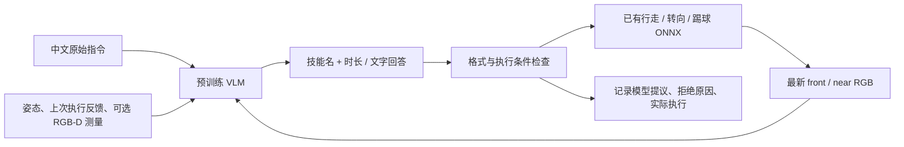

# HD1910 多动作场景与 VLM 数据接口

本实验在本机 HD1910 MuJoCo 仿真中运行，不调用云端大模型 API，不连接实体机器人。红、黄、蓝三个实体球在指定半径范围内随机放置；机器人根据实际相机图像选择目标、搜索、接近、微调、踢球并恢复站立。

**2026-11-15 更新：默认 `--backend rule --teacher efficient` 使用实测运动补偿与视觉闭环教师；`--backend vlm` 保留已有 v1 微调模型；新增 `--backend vlm-v2` 支持通用目标、短动作序列和后台续接推理。** 三条路径复用已训练的行走和踢球 ONNX 模型。原规则基线可用 `--teacher legacy --nominal-motion` 复现。

本次五项改进的实测结果、论文参考、协议、模型选择和运行命令见 [CONTROL_REVISION.md](CONTROL_REVISION.md)。首轮冻结 Qwen3.5 技能头闭环踢球 2/9；其输入错位的旧 388 条样本及相关特征缓存已按用户要求删除。当前保留的是接口对齐后的 102 条样本，尚未重训。下文已有 QLoRA/ONNX 服务与历史成绩仍指 v1，不应当作新技能头成绩。

## 桌面玩具的候选动作与对话合同

默认动作播放器现使用 `--profile toy`：20 个自身动作候选，物体交互仅保留踢球。
轻跳因明显前移暂时排除。叼取、搬运和推物等旧实验需要显式加 `--profile research`。
新版的每回合回复、聊天与动作区别、组合任务、持续行走/停止、SFT 示例及采集前提见
[TOY_DIALOGUE.md](TOY_DIALOGUE.md)。这是可审核的协议和设计示例，尚未接入新版对话执行器或开始训练。

## 既有动作与研究交互演示

三色球场景新增可动鸭嘴、绿色小球、低底座、紫色方块及放置目标垫。
已下载 23 份公开 ONNX 权重，约 19.1 MiB；支持坐站、俯身、前滚翻、左右单脚站立、轻跳、
舞步、左右看和点头，以及固定摆位的叼取→搬运→放下、推方块和原有视觉踢球。
成功动作、失败候选、许可证、物理验收和全部命令见 [ACTIONS.md](ACTIONS.md)。

```bash
# 实时播放自体动作串联；关闭窗口后保存本次轨迹
./experiments/microduck_tasks/actions.sh --showcase

# 实时播放真正接触夹持的小球搬运
./experiments/microduck_tasks/actions.sh --profile research --action pick_place

# 动作播放器，输入“坐站”“抬左脚”“节奏舞步”“踢红球”等；help 查看列表
./experiments/microduck_tasks/actions.sh --interactive
```

新动作使用独立 `microduck-action-demo-1` 记录，明确标注 `training_ready=false`。
它们已接入动作演示和执行层，旧 11 类 VLA 头尚不会选择这些新增类别；不会把动作播放成功混充成 VLA 训练成绩。

## 方案一：冻结 Qwen3.5 的技能选择头

本轮输入为 front/near RGB、原始指令、当前本体状态、RGBD 实体和已执行动作的反馈。
Qwen3.5-2B 保持冻结，使用 NF4 权重量化和 BF16 计算；提取最后一个有效输入 token 的
2048 维融合向量，不生成技能 JSON，也不把教师答案拼入输入。缓存采用 FP16，每条约 4 KiB。
训练场景 3100、验证场景 3101、测试场景 3102；只用决策边界样本，数量为 82/77/74，
排除原 388 条导出中的续接样本。场景编号、帧编号和时间计数不进入网络。

预测类别是有示范支持的 9 种技能加 `answer`、`finish`，不是颜色任务类别。
比较线性头与 32 维隐藏层 MLP，仅凭验证集选择；归一化仅拟合训练集。
本轮**只学习技能选择**：目标由已有指令解析和可见实体绑定，时长由固定配置给出，
`answer` 使用感知结果模板；`approach_target` 内部仍由视觉导航控制器执行。
每次提交一步，不开启尚未训练的动作续接。

2026-11-15 首轮结果：**训练机制跑通，但当前小样本头不能替代教师采集数据。**

| 项目 | 结果 |
|---|---:|
| 选中的头 | 2048 → 32 → 11，65,931 个可训练参数 |
| 三个候选的训练与验证选择时间 | 1.00 s，CPU；不含 VLM 特征提取 |
| `head.pt` | 284,337 bytes，约 278 KiB |
| 233 条完整输入特征提取 | 716.6 s；训练/验证/测试缓存合计不足 1 MiB |
| 训练／验证／测试准确率 | 100% / 87.0% / 89.2%（66/74） |
| 测试 macro-F1，固定 11 类 | 81.3%；测试没有右脚踢球样本，该类记 0 |
| 测试集多数类基线 | 63.5% accuracy |
| 去原始 RGB、保留同样 RGBD 状态的对照 | 90.5% accuracy（67/74），84.5% macro-F1 |
| 新场景闭环踢球 | **2/9**；相同场景规则教师 **9/9** |
| 直接移动／转向 | **4/6**，按实际运动方向验收 |
| 视野问答路由 | 1/1；回答文本由感知模板提供 |
| 完整输入在线预测延迟中位数／P95 | 3.05 / 3.12 s，含 VLM；72 次预测 |

两个成功案例都是蓝球。五个失败任务在没有完成有效踢球时结束，其中一次踢球建议被站稳条件拒绝；
另外两个任务在目标不可见时误选接近，被目标绑定检查中止。左右横移的指令变体被误选为左转。
前进、后退虽然方向执行正确，但后续重复移动被单次动作预算挡住，不能算模型自行正确结束。
离线左脚踢球召回仅 1/3；右脚踢球在离线测试无样本，不能据此声称学会两只脚。

目前只有一个训练场景、三条踢球动作示范，每个普通动作仅一条示范；输入完全去重后为
80/75/72 条，跨 split 未发现完全相同输入。原始 RGB 对照没有体现额外增益，不支持声称已学到
可靠的视觉决策能力。下一轮优先补充不同场景的搜索→接近→踢球→结束边界、左右脚均衡示范、
左右移与转向的指令变体、被拒后的恢复，并让训练历史使用实际技能执行器的语义动作反馈。
当前教师历史记录的是底层动作，而部署会反馈 `approach_target/target_reachable`，也存在分布差异。
上述闭环场景现已用于失败分析；下一轮最终验收应使用新的独立场景。

产物：[训练结果](outputs/frozen_head_20261115/results.json)、
[闭环逐任务结果](outputs/frozen_head_eval_20261115/results.json)、
[相同场景教师对照](outputs/frozen_head_teacher_eval_20261115/results.json)、
[移除原始 RGB 的对照](outputs/frozen_head_text_20261115/results.json)、
[输入重叠审计](outputs/skill_head_input_overlap_20261115.json)。
所有结果保留失败；未根据测试或闭环成绩修改头的超参数或重新选模型。

安装及用当前对齐数据启动新一轮训练的命令（尚未执行这轮训练，新输出目录不可覆盖；不复现上表旧成绩）：

```bash
cd /home/luckysir/Strands_Robots
/home/luckysir/microduck/microduck_rl/.venv/bin/python \
  -m experiments.microduck_tasks.setup_skill_head --download
.cache/microduck_head/venv/bin/python -m experiments.microduck_tasks.extract_head_features \
  --dataset experiments/microduck_tasks/outputs/aligned_plan_dataset_20261115 \
  --output experiments/microduck_tasks/outputs/aligned_head_features_new
.cache/microduck_head/venv/bin/python -m experiments.microduck_tasks.train_skill_head \
  --features experiments/microduck_tasks/outputs/aligned_head_features_new \
  --output experiments/microduck_tasks/outputs/aligned_head_new
.cache/microduck_head/venv/bin/python -m experiments.microduck_tasks.evaluate_skill_head \
  --checkpoint experiments/microduck_tasks/outputs/aligned_head_new/head.pt \
  --output experiments/microduck_tasks/outputs/aligned_head_eval_new --seeds 3400 3401 3402
```

上述历史闭环评估使用 3200/3201/3202 三个场景、每场景三色球，另测 7 个直接运动/问答指令。
采用锁步仿真，模型推理期间暂停物理推进；耗时另记 wall time，不能当作实时控制成绩。
每次保存原始预测、实际执行技能、安全门拒绝及独立物理验收结果。
去掉 RGB、保留文本和同一组 RGBD 状态的对照可用 `extract_head_features --without-images`；
它仍含视觉感知得到的位置，不能称作“完全没有视觉”。

交互试运行使用同一冻结基座和已训练的头：

```bash
.cache/microduck_head/venv/bin/python -m experiments.microduck_tasks.demo \
  --backend head --head-checkpoint experiments/microduck_tasks/outputs/frozen_head_20261115/head.pt \
  --interactive --seed 3200
```

实际运行入口已完成一次实时前进检查（场景 3203）：模型选中前进，执行 0.32 s 后仍预测前进，
由执行器预算终止，状态为 `command_budget_complete`、退出码 2；没有运行异常或仿真故障。
这证明模型加载、执行和录制链路可用，不代表模型自行正确结束任务；
记录见 [实时入口检查](outputs/frozen_head_realtime_smoke_fixed_20261115/summary.json)。
新增来源标记已纳入录制和界面，学生预测仍排除在教师示范导出之外。
本轮实验目录测试 446 项通过，Ruff 检查和格式检查通过。

`.cache/microduck_head/model` 是本次提取特征用的官方 HF 权重，下载约 4.24 GiB；
不生成旧 ONNX 合并/转换目录。头绑定模型修订、量化方式、输入代码与提示哈希，
不能直接搬到已有 GGUF 的隐藏特征上使用。
环境固定 `transformers==5.4.0`、`bitsandbytes==0.49.2`、`fla-core==0.4.1`；输入右侧补齐到
1024 token 的倍数，始终取最后一个有效输入 token。两个未完成的性能探测缓存明确排除在训练之外。

### 训练输入与运行输入的对齐修正

以上是首轮历史成绩。随后已修正采集链路，**尚未用新数据重训技能头**。
旧数据通过 `plan_training_data.chunk()` 把连续底层动作重标为 `approach_target`，
却仍在每个底层动作前采样、将底层动作写入历史。旧训练集 82 条输入中的 345 条历史项
全部是 `completed`，没有一次 `approach_target` 历史。

| 项目 | 首轮训练数据 | 原本的模型运行方式／现在共用的方式 |
|---|---|---|
| 动作历史 | `move_forward/turn/stand` 等底层动作 | 实际提交的语义技能，如 `approach_target` |
| 执行结果 | 统一写成 `completed` | 保留真实 `completed/target_reachable/target_lost` 或拒绝原因 |
| 观察时机 | 每个底层小动作前 | 一个语义技能返回后，踢球包括恢复站立完成后 |
| 动作参数 | 事后合并得到的时长 | 同一映射：接近预算 2 s，直接移动 0.32 s，直接转向 0.6 s |
| 标签来源 | 从未来底层轨迹重建 | 教师在当次真实请求上选择的单步计划 |

图像顺序、RGBD 实体、本体状态及冻结特征编码原本已经共用；问题主要在历史语义和决策边界。
新 `PlanTeacherSession` 与学生都继承 `PlanTaskSession`，通过 `plan_inputs.py` 构造请求，
通过 `selection_plan.py` 共用目标绑定和动作时长。2 s 是接近技能的预算，可以提前返回；
踢球参数仍为 0.5 s，内部恢复站立另需 3 s，完成后才采下一次决策图像。
`completed` 表示技能执行返回，不是任务成功的证明；物理验收结果只用于筛选，不能进入模型输入。

新导出直接保存录制的请求，逐项核验传感器状态、观察帧、此前实际返回的语义历史与计划结果。
被拒或丢失目标的尝试保留在原始记录和后续历史中，不作为成功动作标签。
训练数据、特征缓存及新头携带 `microduck-skill-boundary-1` 和执行合同哈希；
新数据默认不能混入旧数据，旧数据提取特征必须显式使用 `--allow-legacy-inputs`。
原有头和评估报告保留，旧特征缓存已删除；旧头加载元数据仍会标记 `input_contract_aligned=false`。
此次清理释放约 298.9 MiB，未删除 `aligned_teacher_sample_20261115` 或 `aligned_plan_dataset_20261115`；
逐目录记录见 [清理审计](outputs/cleanup_mismatched_inputs_20261115.json)。

对齐验证采集了 3300/3301/3302 三个场景，共 30 个任务：规则教师踢球 9/9、
直接移动／转向 18/18、问答 3/3。导出 37/32/33 条训练／验证／测试样本，共 102 条，
约 4.9 MiB；历史中已实际包含 `target_reachable` 和 `target_lost`。
这是一轮接口验证数据，规模仍小，成绩属于规则教师，不属于学习模型。
见 [对齐审计](outputs/input_alignment_audit_20261115.json) 和
[新数据清单](outputs/aligned_plan_dataset_20261115/manifest.json)。

后续采集与导出使用新的目录名：

```bash
/home/luckysir/microduck/microduck_rl/.venv/bin/python \
  -m experiments.microduck_tasks.collect_plan_teacher --output /path/to/new_raw
/home/luckysir/microduck/microduck_rl/.venv/bin/python \
  -m experiments.microduck_tasks.plan_training_data --input /path/to/new_raw --output /path/to/new_dataset
```

采集保留 RGB 和同次深度感知得到的实体位置，默认不保存原始深度数组，以控制空间。
本次前 23 个任务仍保留已有原始深度记录，达到原 256 MiB 预算后暂停过；
后续以紧凑录制续采剩余 7 个任务，没有覆盖此前任务。原始检查记录占磁盘约 282 MiB。
对齐修正后实验目录测试共 458 项通过，Ruff 检查及格式检查通过。

## 合并后的 ONNX VLM

2026-11-15 清理说明：用户已要求删除 `.cache/microduck_onnx` 中的合并权重、ONNX 转换产物及专用运行环境，释放约 11.49 GiB。下文保留为历史部署记录，当前 `serve_onnx.sh` 需要重建环境并重新导出后才能使用。Qwen3.5 GGUF、Qwen3-VL 原始基座、LoRA 适配器、导出源码与测试记录均保留；详见 [删除审计](outputs/cleanup_onnx_cache_20261115/cleanup.json)。

`final_adapter` 已合并到原始、未量化的 Qwen3-VL-2B-Instruct 基础权重，再导出完整的视觉和语言网络。合并模型在 `.cache/microduck_onnx/merged_model`，默认部署文件在 `.cache/microduck_onnx/int8_compact`。这一步没有重新训练；运行时不再加载 PEFT 适配器。它与下层行走、踢球的 ONNX 技能模型是不同的模型。

第一个终端启动服务，等待 `Ready`：

```bash
cd /home/luckysir/Strands_Robots
./experiments/microduck_tasks/serve_onnx.sh
```

第二个本机桌面终端启动实时仿真：

```bash
cd /home/luckysir/Strands_Robots
./experiments/microduck_tasks/run.sh \
  --backend vlm \
  --vlm-endpoint http://127.0.0.1:8083/v1/chat/completions \
  --vlm-model microduck-onnx \
  --vlm-timeout 90 --vlm-max-steps 120 \
  --interactive --seed 0
```

可逐条输入“你现在看到了什么？”“往前走一点”“向左转一下”“踢红球”。输入 `退出` 关闭仿真；在服务终端按 `Ctrl+C` 释放显存。无需同时运行 `serve_qlora.sh`。两路 RGB 和实际执行反馈仍由模型读取，动作检查、停止通道及固定站立恢复仍由执行器负责。

默认部署使用 ONNX Runtime CUDA：视觉网络 FP16，语言层的 **196 个线性矩阵采用 8 位权重量化**，激活与 KV 缓存保持 FP16。词嵌入和输出 `lm_head` 共享一份 FP16 权重，避免在显存中保存两份相同矩阵。`vision.onnx` 每次处理一路图像，输出最终图像特征和三组 DeepStack 特征；`decoder_int8.onnx` 执行语言解码与技能 JSON 生成，KV 缓存保留在 GPU。Python 保留原始 tokenizer、图像预处理和 MRoPE 位置编号。图像固定为当前 front/near 的 **320×240 RGB**，对应处理后的网格 `[1,16,20]`；改变相机分辨率需要重新导出视觉图。

服务默认按 **128 个 token 分块读取提示词**，并在每次解码运行后回收空闲内存，降低变长输入的显存峰值。可用 `--prefill-chunk-size` 调整分块大小，或用 `--vision-device cpu` 将视觉编码放到 CPU 进行诊断；解码器仍按 `--device` 指定的设备运行。

`manifest.json` 记录全部 ONNX 图及外部权重文件的 SHA256、训练适配器和提示词来源。模型必须连同外部权重文件一起保存，不能只复制很小的 `.onnx` 图文件。启动时校验这些文件，`/health` 和动作记录会显示 `microduck-onnx`、`int8_weight_only` 及实际视觉、语言执行设备。这里的 INT8 是部署时的权重量化，与训练时的 NF4 并不相同，输出可能变化；导出数值检查与任务正确率分别记录。

转换代码分别为 `merge_adapter.py`、`export_onnx_vision.py`、`export_onnx_decoder.py`、`bundle_onnx.py`；服务代码为 `onnx_vlm.py`、`serve_onnx.py`。原始训练权重、`final_adapter` 和 QLoRA 服务保留，可用于对照。

2026-11-15 的实际 GPU 验证记录在 `outputs/onnx_test_20261115/summary.json`。同一组 24 条验证样本全部生成合法响应，type 22/24、skill 21/24、颜色 24/24、时长 21/24、四字段联合匹配 20/24；原 NF4 + LoRA 的联合匹配也是 20/24，但逐条四字段结果只有 19/24 相同，因此转换不保证输出完全一致。该组推理中位数为 2.80 秒。此前试过的 INT4 版本准确率下降，纯 FP16 全 GPU 版本显存不足，均未作为默认部署。

已实际验证问答、前进、后退、左转、实时三视角窗口，以及已对齐脚边红球的踢击和恢复站立（独立物理验收 1/1）。这三项仿真检查共 12 次模型决策，中位耗时为 2.29 秒、范围 1.81～2.82 秒；此前 QLoRA 的同类检查为 5.92 秒，但两次运行的实时画面和状态不完全相同，这不是隔离的性能基准。上述检查不代表随机位置下完整找球、接近和踢球的成功率。踢球录像为 `outputs/onnx_test_20261115/aligned_kick8_compact/demo.mp4`。复核报告可运行 `.cache/microduck_onnx/venv/bin/python -m experiments.microduck_tasks.summarize_onnx_validation`；它只读取现有证据，不重新执行仿真。

## 可视化测试已完成的 QLoRA 模型

首轮训练已于 2026-11-15 完成全部 **2375 次更新、9500 条训练样本**。输出目录为 `outputs/qlora_20261114`，最终权重是 `final_adapter`，并非独立基础模型。自动生成评估使用 24 条固定验证样本：合法 JSON 24/24、type 24/24、skill 22/24、颜色 24/24、时长 20/24、四字段联合匹配 20/24。这里的 skill 统计包括非动作样本的 null；这些离线指标不能视为闭环踢球成功率。最终 32 条固定样本验证损失为 0.009603；按损失选择的 `best_adapter` 来自第 1700 步，损失 0.008398。

在第一个终端加载本地基础权重与最终适配器，等待服务打印就绪信息：

```bash
cd /home/luckysir/Strands_Robots
./experiments/microduck_tasks/serve_qlora.sh
```

在第二个本机桌面终端打开三视角交互窗口：

```bash
cd /home/luckysir/Strands_Robots
./experiments/microduck_tasks/run.sh \
  --backend vlm \
  --vlm-endpoint http://127.0.0.1:8082/v1/chat/completions \
  --vlm-model microduck-qlora \
  --vlm-timeout 90 --vlm-max-steps 120 \
  --interactive --seed 0
```

逐条输入“你现在能看到什么？”“往前走一点”“向左转一下”“把红色的球踢出去”，每条结束后再输入下一条。窗口显示外部视角及 front、near 两路相机。输入“停下”或点击停止按钮可取消当前动作，输入 `退出` 关闭仿真；第一个终端按 `Ctrl+C` 关闭模型服务、释放显存。更换 `--seed` 可改变三球位置。单次模型推理期间仍会维持站立和刷新窗口。

服务只监听 `127.0.0.1:8082`，使用训练环境的 Transformers + PEFT 直接加载 NF4 基础模型与 LoRA，不需要再次训练或调用云 API。它按训练时的双图处理尺寸和 v5 提示词进行贪心生成；JSON 格式由客户端解析和执行检查校验，不把输出修补为正确动作，不回退规则老师。`/health` 与事件轨迹记录实际适配器绝对路径、SHA256 和提示词版本，可核对确实加载了微调模型。原来的 `serve_vlm.sh` 仍是 8081 端口的预训练 GGUF。

要进行有独立物理验收、并保存录像的单条踢球测试，可在服务运行时执行：

```bash
./experiments/microduck_tasks/run.sh \
  --backend vlm \
  --vlm-endpoint http://127.0.0.1:8082/v1/chat/completions \
  --vlm-model microduck-qlora \
  --vlm-timeout 90 --vlm-max-steps 120 \
  --seed 0 --command '把红色的球踢出去' --expected-color red --video
```

这条批量命令在任务结束后生成 `demo.mp4`，不弹出交互窗口；保存目录会打印到终端。交互模式的 `model_reported` 仅表示模型自述完成；批量命令带 `--expected-color` 后，才按目标脚接触、球位移、错球接触及末态稳定等条件独立验收。推理总任务上限仍为 600 秒，超限会记录失败。

若要比较验证损失最优的适配器，先关闭当前模型服务，再启动：

```bash
./experiments/microduck_tasks/serve_qlora.sh \
  --adapter experiments/microduck_tasks/outputs/qlora_20261114/best_adapter
```

2026-11-15 实际服务检查保存在 `outputs/qlora_visual_test_20261115/summary.json`：视觉问答、前进、后退、左转均生成合法响应，三条移动指令均执行一次后停止；已对准脚边的红球 1/1 通过独立物理验收；实时窗口显示和交互前进、退出已验证。12 次决策耗时中位数约 5.92 秒，范围 5.79～6.78 秒。上述是入口与基本行为检查，不是随机位置下完整搜索、接近、对齐、踢球的成功率评估。

## 本地预训练 VLM 调用技能

采用 **Qwen3-VL-2B-Instruct** 官方 GGUF，语言权重 Q4_K_M、视觉投影 Q8_0，通过独立的 llama.cpp 进程运行。权重使用 Apache-2.0 许可证，本地推理不产生云 API 调用费；仍占用本机算力和存储。[官方模型](https://huggingface.co/Qwen/Qwen3-VL-2B-Instruct-GGUF)



模型选择前进、后退、左右横移、左右转向、站立、左脚踢、右脚踢，或给出文字回答。每次只执行一个有时长上限的技能，然后由执行器固定恢复站立，再拍新图询问模型。推理等待期间，底层继续以 50 Hz 维持站立。停止指令直接取消，迟到回复不能启动动作。

首次部署（本机若已部署可跳过）和启动服务：

```bash
python3 experiments/microduck_tasks/setup_vlm.py --download
./experiments/microduck_tasks/serve_vlm.sh
```

另开终端启动带窗口的交互仿真：

```bash
cd /home/luckysir/Strands_Robots
./experiments/microduck_tasks/run.sh --backend vlm --interactive --seed 0
```

服务只监听 `127.0.0.1:8081`，不需要 API key。终端可输入“看看你眼前有什么”“往前走一点”“把红色球踢出去”。原命令不加 `--backend vlm` 时仍使用规则基线，便于比较。

默认模型输入是**真实 RGB + RGB-D 检测得到的球心测量 + 姿态 + 执行历史**。这是带感知辅助的 VLM 技能选择原型；颜色检测和深度拟合仍来自已有感知模块，不能把这些检测能力归功于 VLM。加 `--vlm-rgb-only` 可去掉模型输入中的检测结果，单独评估纯 RGB 决策，但踢球执行检查仍使用 RGB-D。外部观看相机、球的世界坐标和接触真值都不送给模型。

执行检查只接受或拒绝模型提议，不替它计算导航动作，也不回退到 `KickPlanner`。踢球要求目标可见、机身站稳、球位于对应脚的容差范围内；模型需要根据拒绝反馈自己调整。`--vlm-max-steps` 默认 40；连续三次拒绝或超时会结束任务。

使用独立指定的目标验证踢球，而不是拿模型自己说的颜色当正确答案：

```bash
./experiments/microduck_tasks/run.sh --backend vlm --seed 0 \
  --command '把红色的球踢出去' --expected-color red --vlm-max-steps 40
```

`--expected-color` 仅用于单条命令的验收，不进入模型输入。没有它时，文字回答状态为 `answered`，模型自述完成为 `model_reported`；这两种状态都不代表物理任务通过。有它时，只有目标脚接触、位移、无提前推球/错球接触及站稳等检查通过，才标记 `success`。原规则 9/9 成绩不代表此 VLM 的成绩。

新的 `events.jsonl` 分开记录 `model_trace.model_proposal`、`guard_result`、模型耗时、输入状态，以及实际 `decision/execution`；执行器恢复站立标记为 `controller_source=executor`。**模型预测不会自动导出成正确示范标签**，需要独立核验或人工纠正后才用于训练。已有规则示范可以继续导出；当前动作产生的 phase 已移出学生输入，避免泄漏答案。

本机最终原型检查记录在 `outputs/vlm_evaluation_20261114/summary.json`（提示词 v4）：

| 检查 | 真实 VLM 结果 |
| --- | --- |
| 前进、后退、左转 | 三条指令均选择对应技能，执行一次后重新看图并结束 |
| 视野描述 | 返回当前两相机可见的红、黄、蓝物体；辅助检测也能观察到它们 |
| 已对准布局下踢红球 | 1/1 通过独立物理验收：目标脚接触，无提前推球/错球接触，末态站稳 |
| 随机 seed 0 的完整踢红球任务 | **未通过**：目标在盲区时模型请求澄清，没有主动转身搜索 |
| 实时窗口 | VLM 交互前进及退出已验证，推理期间持续显示三视角 |

10 次最终检查推理的本机耗时中位数约 0.49 秒（0.38～0.57 秒）；这不是复杂任务成功率。低层物理验收不验证模型回复的每句话。当前模型仍可能重复动作、混淆转向/横移或提前结束，前期失败日志一并保留。自动化测试现为 **267 项通过**，涵盖接口、拒绝、取消、数据来源和回归；它们不能替代真实 VLM 任务验收。

训练学习“图像 + 指令 + 必要状态 → 技能及参数”。原始 GGUF 用于推理，QLoRA 使用另外下载的官方原始权重。预训练模型的以上成绩与训练后的能力需要分别记录，不能用规则老师的成功率代替模型闭环验收。

## 本地 QLoRA 微调

2026-11-14 首轮数据已采齐并通过独立审计，正式训练进程于北京时间 16:28 启动，2026-11-15 已完成，目录为 `outputs/qlora_20261114`。当前状态请以该目录的 `run_status.json` 和 `train.log` 为准；无需重复执行下面的启动命令。

| 正式数据划分 | 样本数 | 独立种子数 |
| --- | ---: | ---: |
| train | 9,500 | 110 |
| val | 1,299 | 18 |
| test | 1,135 | 18 |

三个集合均覆盖九种技能和红/黄/蓝三色；种子、episode、完整初始布局没有跨集合重复，23,868 张导出 RGB 均与原图哈希一致。剔除了 23 个失败踢球任务的动作监督、9,063 条执行器恢复事件和 100 条直接由停止通道处理的指令。规则老师随机踢球验收为 277/300，其中 187 次搜索后成功；这是采集质量记录，不是微调后 VLM 的成绩。完整证据见 `outputs/training_collection_audit_20261114.json` 和 `outputs/training_audit_20261114/final_dataset.json`。

训练使用官方 `Qwen/Qwen3-VL-2B-Instruct`，固定 revision `89644892e4d85e24eaac8bacfd4f463576704203`。只在语言层添加 rank 8 LoRA；基础语言权重为 NF4 双重量化，视觉编码器、视觉投影和已有 ONNX 动作控制器冻结。单卡 batch 1、梯度累计 4、bf16、梯度检查点；只对助手 JSON 计算损失，图像、指令、状态和最多六步执行历史完整保留，不静默截断上下文。

本机 RTX 4050 6GB 已完成 20 次真实优化更新和检查点恢复，以及梯度累计 4 的四次更新压力测试。训练 CUDA 峰值 allocated 约 3.33 GiB、reserved 约 4.22 GiB，系统显示与驱动另占显存。这些单独的资源测试使用旧版提示词，产物不作为正式模型；正式 v5 训练从官方基础权重重新开始，更新 8,716,288 个 LoRA 参数。9500 条训练样本、累计 4、一个 epoch 对应 2375 次优化更新，按资源试跑速度约需 15–17 小时。详见 `outputs/resource_verification_20261114/resource_verification.json`。

环境位于 `.cache/microduck_train/venv`，权重位于 `.cache/microduck_train/model`。独立环境只读复用 microduck 环境的 Torch/CUDA，其他训练依赖按 `training_requirements.txt` 固定版本安装。重建命令（本机已建立可跳过）：

```bash
cd /home/luckysir/Strands_Robots
/home/luckysir/microduck/microduck_rl/.venv/bin/python \
  -m experiments.microduck_tasks.setup_training --download
```

数据采集计划在运行前固定：100 个随机场景种子，每个种子分别踢三种颜色的球，并单独执行移动、转向、视野问答和歧义指令，共 400 个案例；另加 30 个独立近脚场景种子，共 180 个案例补充左右脚覆盖。最后增加 16 个独立种子，每次复位后分别执行六种移动/转向命令，共 96 个案例，使同一初始画面和姿态对应不同的语言要求。三组合计 146 个种子、676 个案例。所有种子的训练/验证/测试归属预先固定，同一场景的所有颜色、说法和相邻帧始终在同一划分中。近脚补充的成绩单独统计，不能算作从随机远处找到球的成绩。

```bash
/home/luckysir/microduck/microduck_rl/.venv/bin/python \
  -m experiments.microduck_tasks.collect_training \
  --output experiments/microduck_tasks/outputs/training_collection_20261114

/home/luckysir/microduck/microduck_rl/.venv/bin/python \
  -m experiments.microduck_tasks.collect_near_training \
  --output experiments/microduck_tasks/outputs/training_near_collection_20261114

/home/luckysir/microduck/microduck_rl/.venv/bin/python \
  -m experiments.microduck_tasks.collect_direct_reset_training \
  --output experiments/microduck_tasks/outputs/training_direct_reset_collection_20261114
```

采集器退出后可以从同一目录续跑，保留失败轨迹和每次调用记录；同一目录不要同时启动两个采集器。`--workers 3` 可在显存充足时并行采集，只有主线程更新总清单；少于 8 GiB 可用空间时停止。踢球示范必须通过目标脚接触、球位移、无提前推球或错球接触及站稳验收。直接运动还检查真实位移/转向方向。失败踢球任务不导入成功动作监督；同一段记录中可独立成立的视野回答可以保留。

**本轮微调使用 `training_data.py` 导出，不能使用下面历史通用导出器生成的 549 条旧数据。** 新格式与当前逐步技能接口一致：输入为双 RGB、原话、测量状态和执行反馈；输出统一为 `type / skill / seconds / target_color / reply`。提示词版本为 `microduck-skills-5`：模型输入移除任务编号，`sim_time_s` 在训练和推理中均表示当前任务开始后的相对秒数，避免固定命令序号或全局时钟成为答案提示。规则意图、阶段、仿真真值只用于验收和审计，不进入学生输入；固定 1 秒/3 秒恢复站立由执行器负责，不作为模型动作标签，规则主动选择的 0.6 秒站稳保留。

```bash
/home/luckysir/microduck/microduck_rl/.venv/bin/python \
  -m experiments.microduck_tasks.training_data \
  --input experiments/microduck_tasks/outputs/training_collection_20261114 \
  --input experiments/microduck_tasks/outputs/training_near_collection_20261114 \
  --input experiments/microduck_tasks/outputs/training_direct_reset_collection_20261114 \
  --output experiments/microduck_tasks/outputs/training_dataset_final_20261114
```

输出目录须为新目录，数据集写定后不在训练期间追加修改。`manifest.json` 保存划分、各技能计数、被排除记录、源采集快照和 JSONL 的 SHA256。`train_vlm.py` 再校验格式、图像、提示词和所有输入长度，训练记录固定模型/数据哈希、配置、损失、显存与检查点。

正式训练采用一个完整 epoch；`--max-steps 10000` 是上限，数据用完会自动结束。启动前需用 `--resource-smoke` 的短训练实测最长上下文的前向、反向与优化器显存，不以模型能够加载作为训练可行证据。

```bash
.cache/microduck_train/venv/bin/python -m experiments.microduck_tasks.train_vlm \
  --dataset experiments/microduck_tasks/outputs/training_dataset_final_20261114 \
  --output experiments/microduck_tasks/outputs/qlora_20261114 \
  --epochs 1 --max-steps 10000 --grad-accum 4 --rank 8 \
  --eval-every 100 --eval-limit 32 --save-every 50 --predict-limit 24
```

后台启动使用 `launch_training`，默认配置与上面的正式训练一致；选定一种启动方式，避免重复启动。启动记录保存实际 PID、完整命令和数据集哈希，标准输出写入训练目录的 `train.log`：

```bash
.cache/microduck_train/venv/bin/python -m experiments.microduck_tasks.launch_training \
  --dataset experiments/microduck_tasks/outputs/training_dataset_final_20261114 \
  --output experiments/microduck_tasks/outputs/qlora_20261114
```

训练目录的 `run_status.json` 是实际运行状态，`metrics.jsonl` 是逐步指标，`latest_checkpoint.json` 指向最近可恢复检查点；第 10 步先保存一次，此后每 50 步保存，仅保留最近两个完整检查点。`best_adapter` 根据固定验证样本损失选择，`final_adapter` 是最后一步权重，两者都不是独立基础模型。恢复时使用同一命令和原始参数，追加 `--resume` 及 `latest_checkpoint.json` 中的检查点路径。中断时已完成的检查点保留，未完成的梯度累计不会伪装成完整更新。

```bash
tail -f experiments/microduck_tasks/outputs/qlora_20261114/train.log
```

后台训练可继续运行而不必保持聊天或终端打开；电脑仍须保持开机且不休眠。需要中断时，按 `run_status.json` 中的实际 PID 发送 SIGINT，之后从 `latest_checkpoint.json` 指向的完整检查点恢复。

最终示范中有 40 个踢球任务需要超过默认的 40 次模型调用，最长为 117 次。训练后的闭环验收应显式设置 `--vlm-max-steps 120`，并分别报告决策次数超限和 600 秒墙钟超时；近脚任务、随机远处任务、各技能与颜色应分别统计。

验证日志区分 teacher-forced loss 与无约束生成的 JSON 合法率、技能/时长/颜色匹配率；测试集不用于选择检查点。数据仍有类别不均衡，左右横移更多，后退更少；近距离左脚样本不能代替随机远距离搜索和对齐。规则老师还会持续锁定踢球脚，学生只看到六步执行历史，部分旧选择未必能从当前输入完整恢复；首轮保留该限制进行评测，不把老师隐藏状态加入学生输入。这些离线指标仍不能代替仿真闭环评测。训练后需用保留的随机场景和新说法重新运行完整搜索、接近、踢球任务，再决定是否接入日常交互。现有 `serve_vlm.sh` 不会自动加载 LoRA，也不会因训练开始而改变原有仿真行为。

## 规则基线：直接运行

在仓库根目录执行。脚本使用本机已有的 `/home/luckysir/microduck/microduck_rl/.venv/bin/python`，不会安装依赖或下载模型。

```bash
./experiments/microduck_tasks/run.sh --seed 0 \
  --command '现在能看到什么？' \
  --command '帮我把红色的球踢出去' \
  --command '现在眼前有什么？' \
  --video
```

输出自动保存在本目录 `outputs/episode_时间_唯一编号/`。`--video` 在任务结束后重放真实物理轨迹，生成 `demo.mp4` 和 `demo.jpg`。外部视角仅供观看，控制器只使用 front/near 相机。

交互模式默认打开实时窗口：左侧显示机器人和三色球的外部视角，右侧分别显示 `front` 与 `near` 相机画面，显示时间和当前动作。窗口约 15 FPS 更新，控制循环保持 50 Hz；画面读取物理状态快照，不推进或修改仿真。

终端用于输入中文指令。可以输入“停下”，也可以点击窗口底部“停止任务”按钮。关闭窗口、按 Escape 或在终端输入 `exit`，会取消任务并保存记录后退出。

```bash
./experiments/microduck_tasks/run.sh --interactive --seed 0
```

纯终端或无桌面运行时加 `--no-viewer`：

```bash
./experiments/microduck_tasks/run.sh --interactive --no-viewer --seed 0
```

实时窗口需要可用的桌面显示和 Tk。本机已有 Tk/Pillow，无需另外安装；窗口创建失败时会提示检查 `DISPLAY` 或使用 `--no-viewer`。普通批量 `--command` 模式仍按原方式运行，可用 `--video` 生成任务后的录像。

实时窗口已实测完成红球搜索、对齐和踢球；另验证了无显示器模式、执行中停止、Escape/窗口关闭及 Ctrl-C 清理。添加窗口后的自动化测试合计 155 项通过。

可以依次输入：

```text
你现在视野里有什么？
踢红球
停下
往前走
退后一点
向左转
把蓝色那个球踢开
退出
```

每次执行一个任务。忙时除停止/退出外的新指令会提示稍后输入；不会并行执行两个动作任务。“停下”取消当前任务并切回站立控制。停止后下一条明确指令可以启动新任务。前进/后退/横移默认执行 0.32 秒，转向默认 0.6 秒，然后站稳；这些是短动作，不承诺精确位移或角度。

| 功能 | 支持的表达示例 |
| --- | --- |
| 指定颜色踢球 | 踢红球；把黄色的球踢出去；帮我踢一下蓝球 |
| 四向移动 | 往前走；前进一点；后退；退后；向左挪；往右走 |
| 转向 | 向左转；右转一下 |
| 当前视野 | 现在能看到什么；眼前有什么；描述一下你的视野 |
| 停止 | 停下；停止；别动；站住 |

这是有限中文规则，不是自由对话模型。目标不明确、多种颜色冲突、多个动作混在一句、询问能力或叙述过去时会请求澄清。“踢它”可引用上一目标或当前唯一可见颜色。视野问答目前只描述实际检测到的三色球及相对方位，不认识任意物体，也不会把隐藏球说成已看见。

## 随机场景与搜索

默认每球距离初始机器人原点 0.3～0.6 米，方位覆盖整圈，球心间距至少 0.20 米。同一 seed 可复现布局。

```bash
./experiments/microduck_tasks/run.sh --seed 2 --radius-min 0.3 --radius-max 0.6 \
  --command '踢黄球'
```

也可通过 `--layout-json layout.json` 指定三个球的初始 `[x,y]`，单位米；自定义布局用于调试，物理结果不能自动推广到所有布局。

找不到目标时，控制器执行“左转 1 秒 → 站稳 → 再看”的循环，以实际身体朝向计算搜索覆盖范围。累计覆盖一圈仍未检测到目标会退出；另有 120 次决策和 180 秒仿真时间上限。转向使用行走模型的 `yaw=±1 rad/s` 指令，转身伴随少量平移。近场相机看到身体后侧的球时，先转到面对目标再接近。

踢球必须先完成前后、左右对齐，再确认站稳；左右脚分别使用固定的 0.5 秒踢球策略，之后恢复行走模型的零速度站立。全程不瞬移球，不修改机器人位置来完成转向，不在走路与踢球之间重置模型动作历史或电机延迟。

## 相机与控制数据

两个**虚拟 RGB-D 相机**固定在躯干上，各输出 320×240 RGB 和米制深度：

| 相机 | 躯干坐标位置 x/y/z（米） | 朝向 | 用途 |
| --- | --- | --- | --- |
| front | 0.14 / 0 / 0.16 | 向前下方 45°，垂直视场 85° | 寻找和接近 |
| near | 0.17 / 0 / 0.12 | 从前方向后下方 110°，垂直视场 90° | 看清脚前目标、最终对齐 |

near 是本实验为解决脚前盲区增加的视角，不代表实体机器人已经装有第二个相机。之后迁移实体或改成单相机时需要重新验证可观测范围。

识别使用 RGB 颜色区域和深度球面拟合，定位的是球心；不使用 MuJoCo 分割 ID 或世界球坐标。规划输入只有当前检测、身体朝向和站稳状态。独立验收读取仿真接触和球位移，检查指定脚确实在踢球窗口触及目标、没有提前推球、没有触碰其他颜色球、球移动至少 0.12 米、身体未跌倒且末态站稳。验收真值不参与导航或对齐。

## 规则老师接口与训练数据

`vlm.py` 定义 `VisionLanguageInput` 和 `VLMBackend.interpret()`：

```text
当前 RGB 图像 + 中文指令 + 对话上下文
  → Intent(kind, color, direction, seconds, reply)
  → 视觉任务控制器
  → 离散行走/转向/踢球技能
```

`RuleVLMBackend` 为规则基线提供意图和视觉问答。仅替换这个 `interpret()` 接口仍会让 `KickPlanner` 选择后续动作；真正的逐步 VLM 控制使用独立的 `skill_vlm.py:LocalVLMBackend.decide()` 和 `skill_tasks.py:SkillTaskSession`。底层关节控制继续交给现有 ONNX 策略。

每次运行保存：

| 文件 | 内容 |
| --- | --- |
| `episode.json` | seed、初始布局、相机参数、物理参数、模型/源码 SHA256、软件版本 |
| `frames/*_front.png`、`*_near.png` | 每个决策时刻的实际 RGB 图像 |
| `frames/*_depth.npz` | 同时刻深度，单位米 |
| `events.jsonl` | 原话、上下文、意图、观测、阶段、动作、实际执行状态和起止时间、结果 |
| `trajectory.npz` | 连续关节与身体状态、球位置、策略输出，仅供重放与验收 |
| `contacts.json`、`summary.json` | 接触证据、逐任务验收与异常 |

以下为早期通用导出路径，保留用于查看历史数据，不用于本轮微调；本轮使用上文的 `training_data.py`。通用导出生成多模态 `messages`，不运行仿真或训练：

```bash
./experiments/microduck_tasks/run.sh \
  --export-only experiments/microduck_tasks/outputs/你的运行目录 \
  --export-dataset experiments/microduck_tasks/outputs/新的数据集目录
```

输入也可以是包含多个 episode 的父目录。导出包含 RGB 文件及 `train.jsonl`、`val.jsonl`、`test.jsonl`、`manifest.json`，分三类监督：意图解析、实际离散动作、问答/执行回复。意图 JSON 与 `INTENT_SCHEMA` 一致；动作标签包含技能、持续时间及目标颜色。上下文会一起保存，避免“踢它”这类指代失去来源。

对于规则老师，只有**最终任务成功且实际完整执行**的动作才进入成功动作监督；中断、失败、未执行的动作保留在原始日志。相同 seed 的所有 episode 固定进入同一划分，避免相邻帧或同场景同义句泄漏。少量 seed 时验证集/测试集可能为空，导出不人为拆帧凑比例。

规则老师使用 RGB-D，这条旧导出路径的学生 messages 默认只有 RGB、文字和任务上下文；深度/检测结果保留为 teacher 元数据。它仍是需要适配 processor/chat template 的通用格式。本轮正式导出已完成 Qwen3-VL 适配，输入包含 RGB-D 测量结果；后续 RGB-only 模型需要单独验证距离判断能力。

## 规则基线的历史验证

本次最终验收结果保存在 `outputs/acceptance_final/summary.json`：seed 0、1、2，各踢红/黄/蓝一次，共 **9/9 成功**，其中 **8 次需要搜索**。无踢前推球、无非目标球接触，所有案例恢复站立；全程最大倾角 9.29°。这是这些固定随机场景的回归结果，不代表任意布局的成功率。自动化测试为 **152 项通过**。

可查看 `outputs/acceptance_final/seed_0_red/demo.mp4` 与 `seed_0_yellow/demo.mp4`，分别约 40 秒和 36 秒。`outputs/vlm_dataset_final/manifest.json` 对应当时导出的 **549 条样本**：27 条意图、495 条实际动作、27 条回复。这三个 seed 均落入训练分桶，验证/测试分桶为空，因此未用于正式微调；本轮独立划分的数据见上文。

重新运行完整物理验收，输出必须选择新目录：

```bash
env -u PYTHONPATH /home/luckysir/microduck/microduck_rl/.venv/bin/python \
  -m experiments.microduck_tasks.acceptance \
  --output experiments/microduck_tasks/outputs/acceptance_new --seeds 0 1 2
```

| 模块 | 职责 |
| --- | --- |
| `language.py`、`vlm.py` | 规则基线的中文意图和当前视野描述 |
| `skill_vlm.py`、`skill_tasks.py` | 预训练 VLM 逐步决策、校验、实际执行、独立验收 |
| `setup_vlm.py`、`serve_vlm.sh` | 固定版本与哈希的本地模型部署、独立推理服务 |
| `perception.py` | RGB-D 三色球检测与球心拟合 |
| `planner.py` | 搜索、面对目标、接近、对齐、站稳、踢球决策 |
| `skills.py`、`runtime.py` | ONNX 技能、连续 HD1910 物理仿真、相机、停止 |
| `tasks.py` | 任务执行、实际动作日志、独立验收 |
| `dataset.py` | 原始记录、成功样本筛选、VLM messages 导出 |
| `demo.py`、`live_view.py`、`recording.py`、`acceptance.py` | 命令行、实时三视角窗口、视频重放、固定随机种子的整批验收 |

```bash
env -u PYTHONPATH /home/luckysir/microduck/microduck_rl/.venv/bin/python \
  -m pytest -c /dev/null -p no:cacheprovider -q experiments/microduck_tasks
```

踢球模型来源、哈希及 HD1910 适配依据见相邻 `../microduck_kick/README.md`。这里仍采用此前相同的名义电机、延迟和球摩擦参数；球滚动距离不能当作实体预测。原踢球策略部分关节目标超出 XML 软限位，本实验记录该偏差，不通过裁剪冒充已验证的硬件动作。这一结果只适用于当前仿真。

## 新增 RGB 与激光测距支路

2026-11-16 新增 [RGB＋8×8 测距仿真验证](RGB_TOF_SIM_ZH.md)：动态投影测区、RGB/测距融合、
IMU/编码器估计及传感器闭环接近/踢球。独立入口为 `rgb_tof_run`、`rgb_tof_acceptance`；
详细结果、成功和失败回放、仿真假设与复现命令见该报告。旧 RGB-D 入口和 Q0/Q1 训练保持独立。

