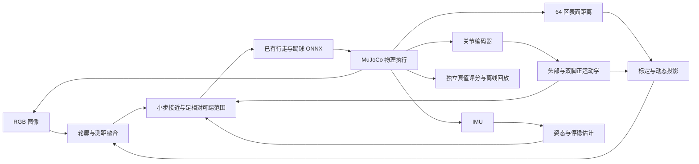

# RGB 与多区测距的仿真闭环

2026-11-16。独立实验入口，未替换 Q0/Q1 的文本训练、旧 RGB-D 数据或实体硬件驱动。

## 实现范围

单个随头运动的 RGB 相机，加左侧 2 cm 的 8×8 测距模块。每区只有一个径向表面距离，
不输出稠密深度、命中物体身份或具体命中子射线。根据相机内参、两传感器外参及当前测距，
把每个测区投影到 RGB；距离变化时投影随视差移动，不能固定为画面上的一个位置。

接近阶段只使用当前 RGB、64 个测距值、模拟 IMU 和关节编码器。
颜色/球形轮廓与测距支持共同产生身体坐标系下的球心；无测距支持就没有可用的融合检测。
球半径 35 mm 是已知场景先验。头部随 RGB 水平和纵向误差调整，关节正运动学更新传感器相对身体的位置。
身体姿态由陀螺仪/加速度互补滤波估计；近似停稳由 IMU 与编码器的时间窗口判定。



仿真器生成传感器和评分时必然使用世界状态；控制决策不接收目标世界位置、身体真值姿态或基座线速度。
`truth()` 拦截只是额外检查，数据边界还通过接口、源代码审查和测试确认，不是安全隔离沙箱。

## 踢球前的姿态交接

原踢球模型不适应持续低头的站姿。控制对照中，头命令为 0、0.15、0.25 rad 时能踢中，
0.35、0.45、0.7 rad 时没有踢中；使用 IMU 估计本身没有阻止踢球。
因此先在低头时完成 RGB/ToF 对齐，停止脚步，把头命令恢复到 +0.2 rad，再检查新 RGB 和停稳状态。

这段交接明确使用短时测距记忆，**不是持续获得球的最新 ToF 回波**：

- 最近的融合位置必须有有效 ToF 来源，记忆不超过 1.4 s；当前 RGB 年龄不超过 0.12 s。
- 新 RGB 依据已知半径独立拟合球心，与锁定位置差不超过 25 mm，并且仍在指定脚的内部区域。
- 红球和红脚在颜色掩膜中连通时，可拟合球的上部真实边界；至少 16 个边界点、130° 弧覆盖，
  拟合残差受限，预测和拟合球轮廓都必须完整落在画面内。不会把裁剪框边缘当成球边缘。
- 球消失、明显移动、轮廓被画面裁切、未停稳或记忆过期时拒绝出脚。该方法不用于搜索或接近。

脚前修正采用小步后停稳再测量。近球丢失只站立尝试重新观测，超时停止，不能继续盲目转身搜索。
踢腿执行与任务成功分开记录：最终以正确脚接触、目标位移、无提前推球、无非目标接触及恢复站立验收。

## 按球相对脚的位置决定出脚

用户提出低头定位后进入可踢范围就直接踢。本轮核对发现 v3 确实存在过度对齐：
left 在球已经可达时仍移动；right 连续后退 44 次，身体横漂和转偏后丢失目标。
left 还出现融合位置仅变化 0.8 mm，就从停稳转为后退的阈值抖动。

新分支用 14 个关节编码器和机构几何计算左右脚 site 位姿，将 RGB/ToF 球心从身体系转换到足系：
`p_foot = R_body_from_foot.T @ (p_ball_body - p_foot_body)`。
这不需要球的世界坐标或仿真身体真值。IMU 用于姿态和停稳估计；头与腿的实际关节角也必不可少。
两脚局部 y 都朝身体左侧，因此判断外侧距离时右脚取负号。

例如球心在身体前方 10 cm、左侧 3 cm，脚原点在前方 0.5 cm、左侧 4.2 cm，
脚朝向近似水平时，球就在左脚前方 9.5 cm、内侧 1.2 cm。控制器先判断这个位置是否可踢，
满足就停稳并进入姿态交接，不再为了到达某个精确点而横移、后退。
已选脚仍可达时保留它，避免左右脚之间因小幅噪声反复切换。

固定动作的 18 例足相对校准见 `foot_reach_calibration_v4/summary.json`：
左右脚分别测试前方 6、9、12 cm 与三个横向位置。9 cm 的 6 例全部严格通过；
右脚 12 cm 的 3 例都踢空；6 cm 有 2 例在正式踢球前擦球。全体指定脚接触 15/18，严格通过 13/18。
该校准使用真值布置球、固定动作和独立评分，不是传感器闭环成功率；单帧感知只检测到其中 13 例。
这说明可踢范围要匹配当前技能，不能假定两脚对称，也不能认为越近越好。

当前采用两脚共同的足前 7–10.5 cm、横向内侧 4.5 cm 至外侧 2.5 cm、球心足上方 1.5–7 cm
作为候选接受区；连续空间内的所有位置并未逐一验证。进入区间后再停稳复测，
抬头交接后的新 RGB 球心也必须通过当前编码器足位姿检查。

只改变足相对决策的冻结 v5 对照为：固定场景 **4/4**、5 mm 噪声及 10% 丢测 **3/4**、
新增八个位置 **5/8**。三批均 `source_changed=false`。失败四例都在出脚前失去可靠融合观测，
图像中红球和红脚连通使完整球轮廓检测拒绝；已实际出脚的 12 例全部严格通过。
条件命中率不能替代 12/16 的整任务完成率，也不能据此承诺任意场景 100%。

v6 补充近脚球轮廓恢复：最近 0.8 s 内的融合位置只限定搜索区域，
在未经裁剪的当前 RGB 掩膜边界上拟合至少 130° 的球弧，然后以至少两个**当前有效 ToF 测区**重新拟合距离。
输出球心来自当前图像和当前测距，未复制历史球心；测距失效、只有单区支持、RGB 无球或弧不足时仍拒绝。
追踪头部使用拟合球轮廓框，不使用球与脚连通后的整块框。
这一接近阶段的恢复与前述抬头交接不同：抬头交接明确使用短时 ToF 记忆，近脚恢复则每次要求新 ToF 支持。
重复缓存帧不会刷新历史时间；超过 0.12 s、负年龄、非有限时间或 RGB/ToF 时间不一致的包不能驱动追踪。

冻结 v6 的完整对照为：固定场景 **4/4**、5 mm 噪声及 10% 丢测 **4/4**、扩展位置 **8/8**，
共 **16/16** 严格通过。每例均有正确脚接触、无提前推球、无非目标接触并恢复站立；
三批 `source_changed=false`，原失败、调参探针和 v5 结果均保留。
这 16 次对应 12 个初始位置，其中固定四个位置重复做噪声测试；扩展失败也用于本轮诊断后复测，
因此这是开发回归结果，不是新的盲测，更不能推导实体或任意环境 100% 成功。
摘要及逐例证据见 `FOOT_REACH_SUMMARY.json`。最终相关回归 **235 项通过**，28 个文件 Ruff 检查及格式检查通过。

## 数据与结果

所有原始输出在 `outputs/rgb_tof_20261116/`，失败和修订前结果均保留。

| 验证 | 当前结果 | 证据 |
|---|---|---|
| 静态定位，2 mm 测距噪声 | 8/8 检测，平均误差 1.37 mm，最大 2.11 mm | `static_validation_v3/summary.json` |
| 静态定位，5 mm 噪声、10% 区域丢失 | 8/8 检测，平均误差 2.70 mm，最大 4.96 mm | `static_validation_noise5mm_drop10_v3/summary.json` |
| 所有 ToF 无效 / 所有距离偏移 +0.3 m | 两轮各两类测试均 8/8 拒绝红球 | 对应静态结果的逐例报告 |
| 靠近红球 | 4/4 独立验收通过 | `navigation_acceptance_v3/summary.json` |
| 靠近红球，5 mm 噪声、10% 丢测 | 4/4 独立验收通过 | `navigation_noise5mm_drop10_v3/summary.json` |
| 激光完全丢失的导航 | 仅站立观测，任务拒绝，没有行走或踢球 | `no_tof_episode/` |
| 旧 v3 踢球固定四场景 | 2/4；center/far 成功，left/right 失败 | `kick_acceptance_v3/summary.json` |
| 旧 v3 踢球，5 mm 噪声、10% 丢测 | 2/4；center/far 成功，left/right 失败 | `kick_noise5mm_drop10_v3/summary.json` |
| 足相对 v5 固定四场景 | 4/4 | `foot_reach_acceptance_v5/summary.json` |
| 足相对 v5，5 mm 噪声、10% 丢测 | 3/4 | `foot_reach_noise5mm_drop10_v5/summary.json` |
| 足相对 v5，新增八个位置 | 5/8 | `foot_reach_extension_v5/summary.json` |
| 足相对＋轮廓恢复 v6，固定四场景 | 4/4 | `foot_reach_acceptance_v6/summary.json` |
| v6，5 mm 噪声、10% 丢测 | 4/4 | `foot_reach_noise5mm_drop10_v6/summary.json` |
| v6，扩展八个位置 | 8/8 | `foot_reach_extension_v6/summary.json` |

静态场景是身体前方 0.14、0.25、0.4、0.6 m，分别左右偏移 0.04 m。
闭环固定场景是红球 `(0.4,0.02)`、`(0.45,0.08)`、`(0.5,-0.08)`、`(0.6,0)` m，种子 17–20。
黄、蓝球固定在 `(0.65,±0.45)` m。它们是小规模开发回归场景，不能解释为任意环境成功率或未见场景盲测。
导航目标距离 0.25 m，容差 0.035 m；最终基线四例独立测得距离 0.259、0.255、0.261、0.268 m。
旧 v3 两组踢球成功例均有正确脚接触、无提前推球/非目标接触并恢复站立；各成功例的姿态交接均为 0.6 s。
v3 侧向失败例在脚前反复修正后无法重获可靠融合观测，停止而未出脚；其四个失败例均没有碰球。
这说明整个感知到踢球链路已能完成，但脚前遮挡和微步控制仍是明确的稳定性限制，不能称为全面通过。

首轮踢球 `kick_acceptance_v1` 为 2/4，第二轮 `v2` 为 1/4，旧 `v3` 为 2/4；全部版本保留。
v3 增加近球丢失停止、所有分支的 90 s/300 次决策预算、水平头跟踪及实测横移脉冲，
没有选择性删除左右失败例。v3 四个闭环批次都记录 `source_changed=false`。
v3 汇总见 `FINAL_SUMMARY.json`。当时相关感知、状态估计、规划器与既有任务回归 **144 项通过**，
Ruff 检查通过；未将这组实验测试宣称为整个仓库 CI。环境提示未安装 pytest-timeout 插件，不影响本次测试结果。

可先查看 [v6 噪声下近足轮廓恢复与踢球回放](outputs/rgb_tof_20261116/foot_reach_noise5mm_drop10_v6/left/overview.gif)、
[足相对左侧踢球回放](outputs/rgb_tof_20261116/foot_reach_acceptance_v5/left/overview.gif)、
[足相对右侧踢球回放](outputs/rgb_tof_20261116/foot_reach_acceptance_v5/right/overview.gif)、
[旧 v3 完整踢球回放](outputs/rgb_tof_20261116/kick_acceptance_v3/center/overview.gif)、
[该次传感器视角](outputs/rgb_tof_20261116/kick_acceptance_v3/center/sensor_trace.gif) 和
[60 cm 接近回放](outputs/rgb_tof_20261116/navigation_acceptance_v1/far/overview.gif)。
第三人称画面由保存轨迹离线重放，仅供审阅，不回馈控制器。

每例保留 `config.json`、`result.json`、`decisions.json`、逐帧 RGB/ToF NPZ、完整感知诊断 JSONL、
传感器叠加 GIF，以及独立评分用的 `trajectory.npz`。最终版本还保存 50 Hz 的
`control_sensors.npz`：IMU、编码器、估计姿态/关节速度、头命令和上一动作。
批量验证运行前保存源码快照、哈希和案例协议；任何崩溃、超时或失败都计入固定分母，不覆盖或重试原例。

## 本机复现

从仓库根目录执行，输出目录必须不存在。依赖本机已有 Microduck 资产及 ONNX 权重：

```bash
env OPENBLAS_NUM_THREADS=1 OMP_NUM_THREADS=1 \
  .cache/microduck_head/venv/bin/python -m experiments.microduck_tasks.rgb_tof_acceptance \
  --output experiments/microduck_tasks/outputs/rgb_tof_reproduce --mode kick
```

`--mode navigate` 验证接近；`--noise .005 --dropout .1` 注入测距噪声和丢区。
`--suite extension` 使用预声明的八个扩展位置；默认 `--kick-strategy foot_relative`，
`--kick-strategy narrow_body` 保留旧狭窄对齐控制分支。
单例入口为 `rgb_tof_run --mode kick --x .4 --y .02 --output <新目录>`。
静态验证入口 `rgb_tof_validate --output <新目录>`；离线回放入口
`rgb_tof_replay --run <已完成单例目录>`。

程序使用 CPU ONNX 与 Mesa 软件 EGL。实际重放记录确认 `llvmpipe`；没有占用 Q1 的 CUDA 显存。
它是锁步仿真，控制计算和渲染期间物理不推进，尚不是实体异步延迟验证。

## 仿真假设与实机边界

- VL53L8CX 8×8 只是依据本地驱动选择的暂定模型，用户尚未确认当前模块型号。
  2 cm 左侧基线、RGB 100° 竖直视场、55° 向下安装角、相机 HOME 身体位置
  `(0.14,0,0.16)` m 均为本次仿真假设，不是实体测量。
- ToF 使用 45° 方形视场、每区 5×5 子射线。选择最近的、12 mm 内至少两根子射线支持的距离簇，
  输出簇中位数。4 cm–2 m 范围、最高 15 Hz；这是几何近似，不是 ST 光学或固件的精确复刻。
- IMU/编码器没有加入实机安装误差、偏置和完整噪声模型；IMU 无法证明匀速滑移不存在。
  标定精确、时间同步、理想球形和已知半径是当前先验。背景距离碰巧兼容时，粗测区仍可能误关联。
- 颜色阈值只覆盖三色球；未验证同色多球、杂乱环境、黑色/反光目标和真实桌边。
- 旧身体模型、嘴部附件、名义电机、延迟和地面摩擦继续沿用。球滚动数米不代表实体距离预测。
- 本轮使用规则控制器和已有底层权重，没有新增模型训练，也没有把 RGB/ToF 接入 Q1 语言微调。
  真机迁移仍需真实内外参、头部几何、测距状态码、同步和相同姿态下的低层技能验证。
